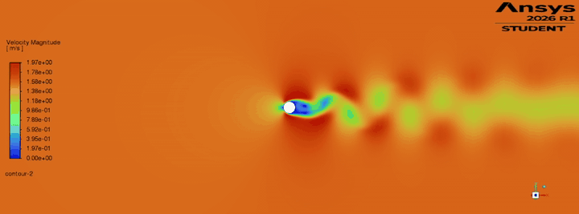

# Cylinder-ML: суррогатная модель обтекания цилиндра

Считаю обтекание цилиндра в OpenFOAM, проверяю точность расчётов и учу ML-модели предсказывать аэродинамику без CFD.


<p align="center"></p>

## Задача

Один нестационарный CFD-расчёт идёт ~2 часа. Цель — модель, которая по числу Рейнольдса Re (позже и по скорости вращения α) за миллисекунды выдаёт:

- **Cd** — коэффициент сопротивления;
- **St** — число Струхаля (частота срыва вихрей);
- **амплитуду Cl** — колебания подъёмной силы.

**Главный вопрос:** сколько CFD-расчётов нужно, чтобы модель была точной, и какая модель лучше.

## Что сделано

| Этап | Результат |
|---|---|
| CFD при Re = 100 | Вихревая дорожка Кармана в OpenFOAM 14 |
| Верификация | Проверены схема по времени и 4 уровня сетки |
| Сравнение с литературой | Cd −1.7%, St −0.7% (сетка 7) |
| OpenFOAM vs Fluent | Та же сетка в Ansys Fluent, сравнение в процессе |
| ML на синтетике | Линейная и полиномиальная регрессия, кросс-валидация |
| Датасет | 25 расчётов OpenFOAM, Re = 20–180, обработка в процессе |

## Верификация CFD

Постановка: D = 1 мм, ν = 1.5·10⁻⁵ м²/с, U = 1.5 м/с → Re = UD/ν = 100. Ламинарный 2D-расчёт, область 100 D, адаптивный шаг по времени (Co ≤ 0.5).

| Схема | Сетка | Ячеек | Ошибка Cd | Ошибка St |
|---|---|---|---|---|
| Euler | 3 | 5 388 | −5.8% | −7.2% |
| backward | 3 | 5 388 | −4.6% | −5.6% |
| backward | 5 | 14 860 | −2.4% | — |
| **backward** | **7** | **29 260** | **−1.7%** | **−0.7%** |
| backward | 9 | — | −1.4% | −0.6% |

Референсы: St = 0.1643 (формула Уильямсона, 1988), Cd ≈ 1.33.

**Выводы:**

- схема 2-го порядка (`backward`) точнее схемы Эйлера на ~1.5%;
- при сгущении сетки ошибка падает всё медленнее (2.2 → 0.7 → 0.3 п.п.) — решение сходится;
- **сетка 7** — компромисс точности и времени (~2 ч на расчёт), её беру для датасета.

<p align="center"></p>

## OpenFOAM vs Ansys Fluent

Та же сетка (29 260 ячеек) перенесена во Fluent через `foamMeshToFluent`.

| | OpenFOAM | Fluent | Разница |
|---|---|---|---|
| Cd | 1.308 | — | — |
| St | 0.163 | — | — |

Ловушки при переносе, найденные по ходу:

- граница `empty` из OpenFOAM стала во Fluent выходом → масса утекала вбок (поймано по балансу массы);
- опорная скорость считалась с границы симметрии → 0 → коэффициенты `inf`.

## ML на синтетических данных

Пока CFD-датасет не готов, методы отрабатываются на синтетике: 30 точек St(Re) по формуле Уильямсона + 1% шума.

| Что проверял | Результат |
|---|---|
| Линейная регрессия (baseline) | Не ловит изгиб кривой, недообучение |
| Полиномы степени 1–15 | Ошибка на test — U-образная: недо- и переобучение |
| Выбор степени кросс-валидацией | Степень 2, RMSE на test 0.0012 (шум 0.0016) |
| 100 точек вместо 30 | Переобучение слабее, лучшая степень 3 |
| Экстраполяция | Все полиномы ломаются за пределами данных |

<p align="center"></p>

## Структура

```
cases/        кейсы OpenFOAM
  sweep_v1/   25 расчётов для датасета, Re = 20–180
scripts/
  make_sweep.py      создаёт кейсы для списка Re
  run_sweep.sh       запускает их по 5 параллельно
  build_dataset.py   собирает Cd, St, Cl → data/dataset_v1.csv + DuckDB
notebooks/
  01_synthetic_strouhal.ipynb    ML на синтетике
  02_forces_Re100.ipynb          анализ одного расчёта
  03_fluent_vs_openfoam.ipynb    сравнение кодов
data/         готовый датасет
figures/      графики для README
```

## Как запустить

Нужны: Linux или WSL2, [OpenFOAM 14](https://openfoam.org/download/14-ubuntu/), Python 3.

```bash
pip install -r requirements.txt
python scripts/make_sweep.py      # создать 25 кейсов
bash scripts/run_sweep.sh         # посчитать (~15 ч)
python scripts/build_dataset.py   # собрать датасет
```

## Дальше по плану 

- [ ] Датасет St(Re), Cd(Re) из OpenFOAM, сравнение с литературой
- [ ] Модели на реальных данных: полиномы, Ridge, физические признаки (1/Re), Random Forest, гауссовский процесс
- [ ] Кривая обучения: сколько расчётов нужно для точности 1%
- [ ] Вращающийся цилиндр: два входа (Re, α), карта режимов
- [ ] Активное обучение против случайного выбора точек
- [ ] SQL-аналитика экспериментов

## Литература

- Williamson C.H.K. (1988). *Defining a universal and continuous Strouhal–Reynolds number relationship for the laminar vortex shedding of a circular cylinder.* Phys. Fluids 31, 2742.
- Celik I.B. et al. (2008). *Procedure for estimation and reporting of uncertainty due to discretization in CFD applications.* J. Fluids Eng. 130, 078001.
- James G., Witten D., Hastie T., Tibshirani R. *An Introduction to Statistical Learning.*

---

**Автор:** _Rustem Karimov_ · [GitHub](https://github.com/rvstxm) · [Telegram](https://t.me/rvstxmq)
